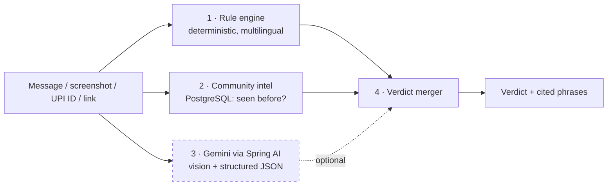

<div align="center">


# Chaukas · चौकस

**AI-assisted scam triage and golden-hour reporting for Indian cyber fraud.**

Check a suspicious message before you pay. If you have already paid, act inside the hour that matters.


[Overview](#overview) · [How it works](#how-it-works) · [Quick start](#quick-start) · [API](#api-reference) · [Architecture](#architecture) · [Testing](#testing) · [Limitations](#limitations)

</div>

---

## Overview

Digital fraud in India is a speed problem. A fake KYC message, a "digital arrest" call or a UPI collect request can move money within minutes. In the first hour after a payment, banks can still freeze funds, but a victim under stress rarely knows what to file, where, or in what words.

Chaukas addresses both moments.

| Capability | When | What it does |
|---|---|---|
| **Check** | Before payment | Accepts a message, link, UPI ID or screenshot and returns a **HIGH / MEDIUM / LOW** verdict, the scam type, and the exact phrases that triggered it, highlighted in the original text. |
| **Golden hour** | Right after payment | Accepts a narrative or chat and payment screenshots, extracts the **amount, UTR, payee and time**, starts a 60-minute countdown, and drafts a 1930 call script, a cybercrime.gov.in complaint, a bank fund-freeze email and a scammer UPI report. |
| **Family guardian** | Ongoing | Links a parent to a guardian. When the parent checks something that looks like a serious scam, the guardian is alerted with the scam type only, never the message. |

The interface is available in **English, हिन्दी and ਪੰਜਾਬੀ**.

## How it works

Detection is layered: deterministic rules first, AI second, with a cited reason for every flag.



**Design principles**

- **Graceful degradation.** If Gemini is unavailable, slow or unconfigured, the rule engine and community intel still return a verdict. The AI adds context and reads screenshots; it is never a single point of failure.
- **Grounded citations.** Every flag cites a phrase present in the analysed text. AI-suggested phrases that do not appear in the content are discarded.
- **No false assurance.** The lowest verdict is "no known red flags", accompanied by a reminder that it is not a guarantee of safety.
- **Human in the loop.** Chaukas prepares drafts. Nothing is filed automatically.
- **Privacy by design.** Check history stores a SHA-256 hash rather than the message. Guardian alerts contain the scam type only.

### Rule engine coverage

Fake KYC, digital arrest, UPI collect requests, investment and trading groups, task and part-time-job scams, prize and lottery, parcel and customs, OTP/PIN harvesting, electricity-bill threats and fake refunds. Link analysis covers lookalike brand domains, URL shorteners, raw IP hosts and suspicious TLDs. Patterns exist in English, romanised Hindi, Devanagari and Gurmukhi.

## Quick start

**Prerequisites:** Docker with Compose. For local development without Docker: JDK 21, Maven 3.9+ and Node 18+.

```bash
git clone https://github.com/Kavaykhurana/chaukas.git
cd chaukas
cp .env.example .env     # optional: set GEMINI_API_KEY; works without it (rules + intel only)
docker compose up --build
```

Open <http://localhost:3000> and choose **Try demo login**.

| Demo account | Email | Password |
|---|---|---|
| Parent (ward) | `parent@demo.chaukas.in` | `chaukas-demo` |
| Child (guardian) | `child@demo.chaukas.in` | `chaukas-demo` |

> Demo accounts and sample scam intel are created only when `SEED_DEMO=true`. Set it to `false` for any real deployment.

**Suggested walkthrough**

1. In **Check**, choose *Use sample message* (a fake KYC scam), or paste `sbi.kyc.helpdesk@oksbi` to see a "seen before" escalation.
2. In **Golden hour**, paste the contents of [`docs/sample-payment-chat.txt`](docs/sample-payment-chat.txt).

<details>
<summary><b>Run without Docker</b></summary>

```bash
# API on :8080 (H2 in-memory database, demo data seeded)
cd backend && mvn spring-boot:run

# Web on :5173 (Vite proxies /api to :8080)
cd frontend && npm install && npm run dev
```
</details>

### Configuration

All settings are environment variables; see [`.env.example`](.env.example).

| Variable | Default | Description |
|---|---|---|
| `GEMINI_API_KEY` | _empty_ | Optional. Enables screenshot reading and AI context. Empty runs in rules-only mode. |
| `GEMINI_MODEL` | `gemini-2.0-flash` | Gemini model used through Spring AI. |
| `JWT_SECRET` | dev placeholder | **Required in production.** At least 32 random bytes, e.g. `openssl rand -hex 32`. |
| `DB_PASSWORD` | `chaukas` | PostgreSQL password. Change for any shared environment. |
| `SEED_DEMO` | `true` | Seed demo accounts and sample intel. Use `false` in production. |
| `CORS_ORIGINS` | `http://localhost:3000` | Allowed browser origins. |

## API reference

| Method | Path | Auth | Purpose |
|---|---|---|---|
| `POST` | `/api/checks` | Optional | Multipart (`text`, `image`, `lang`) or JSON. Returns verdict, signals and seen-before hits. |
| `GET` | `/api/intel/lookup?kind=UPI&value=…` | None | Look up a UPI ID, phone number or domain in the community store. |
| `POST` | `/api/incidents` | JWT | Multipart (`narrative`, `images[]`, `lang`). Returns extracted facts, countdown and drafts. |
| `POST` | `/api/incidents/{id}/report` | JWT | Mark an incident as filed; optionally contributes the payee to community intel. |
| `GET` | `/api/incidents`, `/api/incidents/{id}` | JWT | Incident history and live countdown. |
| `POST` | `/api/auth/register`, `/api/auth/login` | None | JWT authentication (BCrypt-hashed passwords). |
| `POST` | `/api/guardians/invites`, `/api/guardians/accept` | JWT | Link a ward and a guardian. |
| `GET` | `/api/guardians/alerts` | JWT | Guardian alert inbox. |
| `GET` | `/api/health` | None | `{"status":"ok","ai":"gemini" \| "rules-only"}` |

```bash
curl -s localhost:8080/api/checks -H 'Content-Type: application/json' \
  -d '{"text":"Your SBI account will be blocked today. Complete KYC: http://sbi-kyc-update.xyz","lang":"en"}'
```

## Architecture

```
backend/src/main/java/in/chaukas/
├── core/        Framework-free detection engine: rules, domains, extractor, merger, kit generator, i18n
├── domain/      JPA entities
├── repo/        Spring Data repositories
├── service/     Check, Incident, Intel, Guardian, Auth, GeminiAnalyzer (Spring AI)
├── web/         REST controllers, DTOs, error handling
└── config/      Security (JWT, CORS, rate limiting), properties, demo seeder
frontend/        React 18 + Vite + Tailwind: Check, Golden hour, Family; three-language UI
docs/            Deployment guide, demo script, submission checklist, prototype deck
```

**Notable decisions**

- **A framework-free `core`.** The component that decides "scam or not" is plain Java with no framework dependencies, so it can be compiled and tested with `javac` alone.
- **Provider-agnostic AI.** Gemini is reached through its OpenAI-compatible endpoint with the Spring AI OpenAI starter, so changing models is a configuration change.
- **Bounded AI latency.** Virtual threads run the AI call under a hard timeout (default 10 s); on timeout the response degrades to rules and intel.
- **Rate limiting.** An in-memory limiter (20 requests/minute/IP) protects the two endpoints that can consume AI quota.
- **Schema ownership.** Flyway manages the schema; the same migrations run on PostgreSQL (production) and H2 (development and tests).

## Testing

```bash
cd backend

# Detection core: no framework required (40 checks)
javac -encoding UTF-8 -d /tmp/core-out \
  src/main/java/in/chaukas/core/*.java src/test/java/in/chaukas/core/CoreSmoke.java
java -Dfile.encoding=UTF-8 -cp /tmp/core-out in.chaukas.core.CoreSmoke

# Full suite, including the MockMvc API flow on H2
mvn test
```

Coverage includes every scam family, multilingual messages, the never-says-safe guarantee, community-intel escalation, behaviour with the AI disabled, OCR-text ingestion, identifier extraction, golden-hour fact extraction and draft generation.

## Deployment

The repository ships with a `docker-compose.yml` for single-host deployment, a `render.yaml` blueprint for the API and database, and a `vercel.json` for the frontend. See [`docs/DEPLOY.md`](docs/DEPLOY.md) for step-by-step instructions.

## Limitations

- **Not a legal or law-enforcement service.** Chaukas prepares drafts; filing is the user's action.
- **Finite rule coverage.** New scam scripts may evade the rules until the community store or the AI layer catches them, which is why the layers exist.
- **Community intel starts small.** Demo mode seeds a few sample entries. Production starts empty and grows from confirmed reports.
- **AI quality varies** on low-quality screenshots, and free-tier quotas apply. Facts that cannot be found are shown as "please add", never guessed.
- **Per-instance rate limiting.** Multi-instance deployments need a shared limiter.

## Roadmap

- [ ] WhatsApp / SMS share-sheet intake
- [ ] Bank-specific freeze-request templates and nodal-officer directory
- [ ] Voice-note scam detection for "digital arrest" calls
- [ ] Federated, privacy-preserving intel sharing with banks and payment providers
- [ ] Additional Indian languages (Bengali, Tamil, Telugu, Marathi)

## Documentation

- [Deployment guide](docs/DEPLOY.md)
- [Demo script](docs/DEMO_SCRIPT.md)
- [Submission checklist](docs/SUBMISSION_CHECKLIST.md)
- [Prototype deck (PDF)](docs/Chaukas_Prototype_Deck.pdf)

## License

Released under the [MIT License](LICENSE).

---

<div align="center">

If in doubt: **don't pay, don't share an OTP, call 1930.**

Built for CodeVerse 2026 (Open Innovation Hackathon).

</div>
