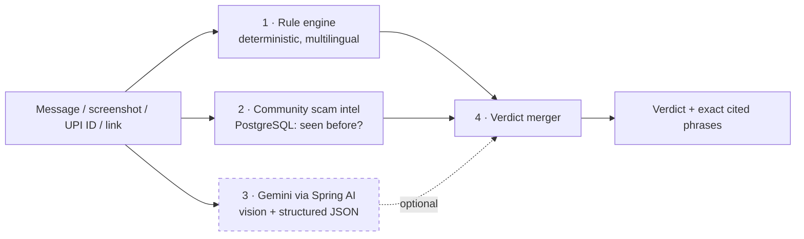

<div align="center">


# Chaukas · चौकस

### Paste the message. Get the verdict. If you've already paid, beat the golden hour.

**AI scam triage and golden-hour reporting for Indian cyber fraud.**


*CodeVerse 2026 · Open Innovation Hackathon · Prototype round*

</div>

---

## The problem

India's digital fraud is a speed problem. A fake KYC message, a "digital arrest" video call, a collect request: the victim pays within minutes. After that, the **first hour** is when banks can still freeze the money, and that is exactly when a panicking victim doesn't know what to file, where, or in what words.

Chaukas covers both moments:

| | Moment | What Chaukas does |
|---|---|---|
| 🛡️ **Mode 1: Check** | *Before you pay* | Paste a message, link, UPI ID or screenshot. Get **HIGH / MEDIUM / LOW**, the scam type, and the **exact phrases** that triggered it, highlighted in your own text. |
| ⏱️ **Mode 2: Golden hour** | *Right after you pay* | Paste what happened or upload the chat and payment screenshots. Chaukas extracts **amount, UTR, payee, time**, starts a 60-minute countdown and drafts a **1930 call script**, a **cybercrime.gov.in complaint**, a **bank fund-freeze email** and a **scammer UPI report**. |
| 👨‍👩‍👧 **Family guardian** | *Protecting parents* | Link a parent. When they check something that looks like a serious scam, you get an alert (scam type only, never their message). |

All three work in **English, हिन्दी and ਪੰਜਾਬੀ**.

## How it decides

> **Rules first, AI second, reasons always.**



- **If Gemini is down, slow or has no key, steps 1 and 2 still return a verdict.** The AI can add context and read screenshots; it can never be the single point of failure.
- **Every flag cites a phrase that is actually in the text.** AI-suggested phrases that don't appear in the analysed content are dropped.
- **It never says "safe".** The lowest answer is *"no known red flags"*, with a reminder that this is not a guarantee.
- **Nothing is auto-filed.** Chaukas prepares drafts; the victim sends them.
- **Privacy:** check history stores a SHA-256 hash, never the message. Guardian alerts carry the scam type only.

## Quick start

```bash
git clone <your-repo-url> chaukas && cd chaukas
cp .env.example .env          # optional: add GEMINI_API_KEY (works without it, rules + intel only)
docker compose up --build
```

Open **http://localhost:3000** and press **Try demo login**.

| Demo account | Email | Password |
|---|---|---|
| Parent (ward) | `parent@demo.chaukas.in` | `chaukas-demo` |
| Child (guardian) | `child@demo.chaukas.in` | `chaukas-demo` |

Try these in the **Check** tab: *Use sample message* (fake KYC), or paste `sbi.kyc.helpdesk@oksbi` to see a **Seen before** escalation. Then open **Golden hour** and paste [`docs/sample-payment-chat.txt`](docs/sample-payment-chat.txt).

<details>
<summary><b>Run without Docker</b></summary>

```bash
# API: H2 in-memory, demo data seeded
cd backend && mvn spring-boot:run

# Web: http://localhost:5173 (Vite proxies /api to :8080)
cd frontend && npm install && npm run dev
```
</details>

## API

| Method | Path | Auth | Purpose |
|---|---|---|---|
| `POST` | `/api/checks` | optional | Multipart (`text`, `image`, `lang`) or JSON → verdict, signals, seen-before hits |
| `GET` | `/api/intel/lookup?kind=UPI&value=…` | none | Is this UPI / PHONE / DOMAIN in the community store? |
| `POST` | `/api/incidents` | JWT | Multipart (`narrative`, `images[]`, `lang`) → extracted facts, countdown, drafts |
| `POST` | `/api/incidents/{id}/report` | JWT | Mark as filed; optionally feeds payee into community intel (confirmed) |
| `GET` | `/api/incidents` · `/{id}` | JWT | History and live countdown |
| `POST` | `/api/auth/register` · `/login` | none | JWT auth (BCrypt) |
| `POST` | `/api/guardians/invites` · `/accept` | JWT | Link a ward and a guardian |
| `GET` | `/api/guardians/alerts` | JWT | Guardian inbox |
| `GET` | `/api/health` | none | `{"status":"ok","ai":"gemini" \| "rules-only"}` |

Example:

```bash
curl -s localhost:8080/api/checks -H 'Content-Type: application/json' \
  -d '{"text":"Your SBI account will be blocked today. Complete KYC: http://sbi-kyc-update.xyz","lang":"en"}'
```

## Architecture

```
backend/src/main/java/in/chaukas/
├── core/        Framework-free detection engine (rules, domains, extractor, merger, kit generator, i18n)
├── domain/      JPA entities          ├── repo/     Spring Data repositories
├── service/     Check, Incident, Intel, Guardian, Auth, GeminiAnalyzer (Spring AI)
├── web/         REST controllers, DTOs, error handler
└── config/      Security (JWT, CORS, rate limit), properties, demo seeder
frontend/        React 18 + Vite + Tailwind: Check · Golden hour · Family, 3-language UI
docs/            Demo script, submission checklist, deployment guide, prototype deck
```

Design choices worth knowing:

- **`core` has zero framework dependencies**, so the part that decides *scam or not* is plain Java, unit-testable with `javac` alone.
- **Gemini through Spring AI** uses Google's OpenAI-compatible endpoint with the Spring AI OpenAI starter, so swapping models is a config change.
- **Virtual threads** handle the AI call with a hard timeout (default 10 s); a timeout degrades to rules + intel.
- **In-memory rate limit** (20 req/min/IP) on the two endpoints that can spend AI quota.
- **Flyway** owns the schema; the same SQL runs on PostgreSQL (prod) and H2 (dev/test).

## What the rule engine covers

Fake KYC · digital arrest · UPI collect requests · investment / trading groups · task and part-time-job scams · prize and lottery · parcel and customs · OTP/PIN harvesting · electricity-bill threats · fake refunds. Plus link analysis: lookalike brand domains, shorteners, raw IP hosts, suspicious TLDs. Patterns exist in English, romanised Hindi, Devanagari and Gurmukhi.

## Tests

```bash
cd backend
javac -encoding UTF-8 -d /tmp/core-out src/main/java/in/chaukas/core/*.java src/test/java/in/chaukas/core/CoreSmoke.java
java -Dfile.encoding=UTF-8 -cp /tmp/core-out in.chaukas.core.CoreSmoke     # 40/40 checks
mvn test                                                                     # + MockMvc API flow on H2
```

Covered: the deck's sample message, every scam family, multilingual messages, the never-says-safe guarantee, community-intel escalation, AI-optional behaviour, OCR-text ingestion, identifier extraction, golden-hour facts (19 min elapsed → 41 left) and the drafts.

## Honest limitations

- **Not a legal or police service.** It prepares drafts; filing is the user's action.
- **Rule coverage is finite.** New scam scripts will slip past rules until the community store or the AI catches them. That is why the layers exist.
- **Community intel starts small.** Demo mode seeds a few sample entries; production starts empty and grows from confirmed reports.
- **Gemini quality varies on low-quality screenshots**, and free-tier quotas apply. Facts that can't be found are shown as "please add", never guessed.
- **Rate limiting is per instance.** Multi-instance deployments need a shared limiter.

## Roadmap

- [ ] WhatsApp / SMS share-sheet intake
- [ ] Bank-specific freeze-request templates and nodal-officer directory
- [ ] Voice-note scam detection (digital arrest calls)
- [ ] Federated, privacy-preserving intel sharing with banks and PSPs
- [ ] More Indian languages (Bengali, Tamil, Telugu, Marathi)

## Docs

[`docs/DEPLOY.md`](docs/DEPLOY.md) · [`docs/DEMO_SCRIPT.md`](docs/DEMO_SCRIPT.md) · [`docs/SUBMISSION_CHECKLIST.md`](docs/SUBMISSION_CHECKLIST.md)

<div align="center">

If you're ever in doubt: **don't pay, don't share an OTP, call 1930.**

*Built for CodeVerse 2026.*

</div>
